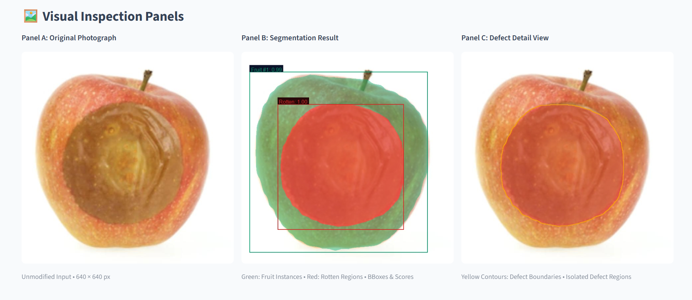
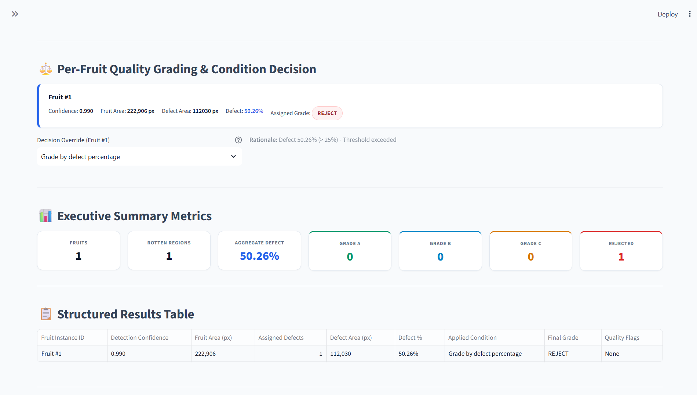

# Automated Fruit Quality Grading and Surface Defect Quantification Using Deep Learning & Computer Vision

[](https://www.python.org/)
[](https://pytorch.org/)
[](https://streamlit.io/)
[](LICENSE)
[](FruitQualityDashboard/tests)
[](https://fruit-quality-grading-maskrcnn.streamlit.app/)

> An end-to-end deep learning and computer vision framework for autonomous fruit surface defect segmentation, pixel-accurate surface defect quantification, and industrial quality grading using a custom **Mask R-CNN (ResNet-50 FPN v2)** enhanced with a **Convolutional Block Attention Module (CBAM)**.

---

## 📸 Live Dashboard Preview

Demonstration on a defective apple sample using our custom CBAM Mask R-CNN model:

| Multi-Panel Instance Segmentation & Defect Isolation | Quality Grading & Executive Metrics Summary |
|:---:|:---:|
|  |  |
| *Visual Inspection Panels: Original photograph, predicted fruit & defect masks, and contour isolation* | *Automated surface defect percentage calculation, industrial grading decision, and structured results table* |

---

## 🌟 Highlights

- **Custom CBAM Attention:** Augments FPN pyramid feature maps with joint channel and spatial attention to accurately detect fine fungal blemishes and subtle surface decay.
- **Two Foreground Instance Classes:** Delineates individual `fruit` boundaries and localized `rotten_region` patches simultaneously.
- **Exact Defect Quantification Math:** Resolves overlapping fruit ownership via confidence ranking and computes area-weighted defect surface percentages.
- **Disjoint Industrial Grading Standards:** Implements objective sorting into **Grade A**, **Grade B**, **Grade C**, and **REJECT** with an operator override mechanism.
- **Executive Light Dashboard:** Interactive Streamlit interface featuring three visual inspection panels, dynamic threshold sliders, and real-time defect boundary contour isolation.
- **Complete Export Suite:** One-click downloads for high-resolution annotated PNGs, CSV results tables, structured JSON inspection reports, and publication-ready summary graphics.

---

## 🌐 Live Cloud Deployment

The application is deployed and running live on **Streamlit Community Cloud**:

### 🚀 [Launch Live App: fruit-quality-grading-maskrcnn.streamlit.app](https://fruit-quality-grading-maskrcnn.streamlit.app/)

[](https://fruit-quality-grading-maskrcnn.streamlit.app/)

> Users can upload fruit photographs and evaluate surface defect quantification in real time directly from any desktop browser or mobile device without installing local dependencies.

---

## 📁 Repository Architecture

```text
.
├── .gitattributes             # Git LFS configuration for tracking large .pth model weights
├── .gitignore                # Production ignore patterns for caches, venvs, and outputs
├── LICENSE                   # Open-source MIT License
├── README.md                 # Project documentation and deployment manual
├── packages.txt              # Debian packages for Streamlit Cloud (git-lfs)
├── requirements.txt          # Python dependency specifications with CPU wheel index
├── setup_and_run.bat         # 1-Click Windows 11 virtual environment & launch script
└── FruitQualityDashboard/
    ├── app.py                # Streamlit UI & executive light theme dashboard
    ├── model.py              # Mask R-CNN ResNet-50 FPN v2 + CBAM attention architecture
    ├── inference.py          # Preprocessing, forward pass, and defect-to-fruit association
    ├── grading.py            # Objective disjoint grading rules & Rotten override logic
    ├── visualization.py      # High-resolution overlays, defect contours, and summary cards
    ├── packages.txt          # Container dependencies
    ├── requirements.txt      # Dashboard-specific dependency requirements
    ├── setup_and_run.bat     # Local launcher
    ├── .streamlit/
    │   └── config.toml       # Streamlit light theme and server configuration
    ├── models/
    │   ├── .gitkeep          # Model directory placeholder
    │   └── best_maskrcnn_cbam_fpn.pth  # Trained model checkpoint (175.6 MB via Git LFS)
    ├── samples/              # Sample fruit test images for instant demonstration
    ├── outputs/              # Destination directory for user-exported results
    └── tests/
        ├── test_grading.py   # Unit tests for interval boundaries and manual overrides
        ├── test_inference.py # Unit tests for synthetic mask overlaps and defect ownership
        └── test_model.py     # Unit tests for CBAM modules and checkpoint loader
```

---

## 🧠 Deep Learning Architecture

The model combines a feature-pyramid instance segmentation detector with dual-domain attention:

```
Input Photograph [3, H, W]
       │
       ▼
ResNet-50 Feature Extractor
       │
       ▼
Feature Pyramid Network (FPN) ──► Levels P2, P3, P4, P5, P6
       │
       ▼
CBAM Attention Modules ────────► Channel Attention (CAM) + Spatial Attention (SAM)
       │
  ┌────┴──────────────────────────┐
  ▼                               ▼
Region Proposal Network (RPN)   RoIAlign Feature Extractor
                                  │
                                  ├─► Fast R-CNN Predictor (Boxes & Confidence)
                                  └─► Mask R-CNN Predictor (Binary Mask Heatmaps)
```

### 1. Convolutional Block Attention Module (CBAM)
Each FPN scale level $P_k$ passes through an attention submodule:
1. **Channel Attention Module (CAM):**
   $$\mathbf{M}_c(\mathbf{F}) = \sigma\Big(\text{MLP}\big(\text{AvgPool}(\mathbf{F})\big) + \text{MLP}\big(\text{MaxPool}(\mathbf{F})\big)\Big)$$
   where the shared MLP contains $1 \times 1$ convolutions with a reduction ratio $r=16$.
2. **Spatial Attention Module (SAM):**
   $$\mathbf{M}_s(\mathbf{F}') = \sigma\Big(f^{7\times 7}\big([\text{AvgPool}(\mathbf{F}'); \text{MaxPool}(\mathbf{F}')]\big)\Big)$$
   where $f^{7\times 7}$ is a spatial convolution with kernel size $7 \times 7$.

### 2. Category Mapping
| Class ID | Semantic Category | Description |
|:---:|:---:|---|
| `0` | `background` | Internal detector background |
| `1` | `fruit` | Entire external visible surface of the fruit |
| `2` | `rotten_region` | Localized decay, surface rot, bruising, or fungal lesion |

---

## 📐 Surface Defect Quantification & Mathematical Rules

### 1. Defect Percentage Formula
For each detected fruit instance $i$:
$$\text{Defect Percentage}_i = 100 \times \frac{\text{Defective Pixels inside Fruit Mask } i}{\text{Total Pixels in Fruit Mask } i}$$

### 2. Exclusive Fruit Ownership
When multiple fruits overlap in the photograph, pixels are assigned exclusively to the **highest-confidence fruit** first:
$$M_{\text{exclusive}, i} = M_i \setminus \bigcup_{j < i} M_j \quad (\text{sorted by detection score descending})$$
This prevents overlapping background fruit regions from distorting the denominator.

### 3. Defect-to-Fruit Association
- Each predicted rotten patch $R_k$ is evaluated against all exclusive fruit masks $F_i$:
  $$\text{Overlap}(R_k, F_i) = \frac{|R_k \cap F_i|}{|R_k|}$$
- The defect is assigned to Fruit $i$ if $\max_i \text{Overlap}(R_k, F_i) \ge 30\%$.
- Defect instances with insufficient overlap ($< 30\%$) or situated outside fruit contours are categorized as **Orphan Defects** and listed separately to avoid false penalties.

### 4. Overlapping Defect Merging
Multiple defect masks assigned to the same fruit are combined via binary union ($R_{\text{union}} = \bigcup_k R_k$) before calculating the intersection with the fruit mask.

### 5. Small / Invalid Mask Guard
Fruit masks with an area smaller than $50 \text{ pixels}$ are flagged as `invalid_small_fruit_mask`, and their percentage is marked as `UNAVAILABLE` rather than reporting an unrepresentative ratio.

---

## 🏆 Quality Grading Standards

The application applies disjoint numeric intervals matching commercial agricultural sorting standards:

| Condition Decision | Calculated Defect Surface | Assigned Grade | Quality Level & Commercial Routing |
|:---:|:---:|:---:|---|
| Fresh Fruit | $0.0\% \le \text{Defect} < 5.0\%$ | **Grade A** | **Premium Export Quality** (Highest tier) |
| Fresh Fruit | $5.0\% \le \text{Defect} < 15.0\%$ | **Grade B** | **Standard Retail Quality** (Supermarkets) |
| Fresh Fruit | $15.0\% \le \text{Defect} \le 25.0\%$ | **Grade C** | **Processing Quality** (Jams, juices, purees) |
| Fresh Fruit | $\text{Defect} > 25.0\%$ | **REJECT** | **Substandard** (Discard / animal feed) |
| Rotten (Override) | Any percentage | **REJECT** | **Pathological Decomposition** (Immediate discard) |

> **Honest AI Design:** The segmentation model predicts `fruit` and `rotten_region` mask instances; it does not predict an independent biological freshness flag. The UI provides a per-fruit dropdown allowing an operator to apply **`Rotten — force reject`** if pathological decomposition is observed, immediately setting the final decision to **REJECT**.

<p align="center">
  
  <br>
  <em>Figure 1: Automated quality grading decision card, executive metrics summary, and structured per-fruit inspection results table.</em>
</p>

---

## 🖥️ Visual Inspection Panels

The dashboard features an executive light theme with high-contrast typography:
- **Panel A (Original Photograph):** The unmodified input image with resolution metadata.
- **Panel B (Segmentation Result):** Emerald green semi-transparent fruit masks, crimson defect masks, bounding boxes, confidence scores, and legend.
- **Panel C (Defect Detail View):** Highlights yellow defect boundary contours and provides an isolated defect view.

<p align="center">
  
  <br>
  <em>Figure 2: Multi-panel visual inspection demonstrating simultaneous fruit instance detection and defect isolation on a defective apple.</em>
</p>

---

## 💾 Exportable Outputs

Export inspection records at the bottom of the dashboard:
1. **Annotated Image (PNG):** Rendered at the original image resolution with vector-sharp bounding boxes and labels.
2. **Results Table (CSV):** Tabular data with confidence scores, pixel counts, defect percentages, applied conditions, and final grades.
3. **Structured JSON Report:** Complete metadata including image dimensions, detection thresholds, bounding box coordinates, and pixel areas.
4. **Summary Card Graphic (PNG):** An executive summary graphic suitable for research papers, presentations, or printouts.

---

## 💻 Local Setup & Installation

### Option 1: 1-Click Launch (Windows 11)
Simply double-click:
```bat
setup_and_run.bat
```
The script will verify Python, initialize a local virtual environment (`.venv`), install dependencies, detect CUDA/CPU hardware, and launch the dashboard in your default browser.

### Option 2: Manual Terminal Setup
```bash
# Clone the repository
git clone https://github.com/Ashish-1506/Fruit-Quality-Grading-MaskRCNN.git
cd Fruit-Quality-Grading-MaskRCNN/FruitQualityDashboard

# Create and activate virtual environment
python -m venv .venv
source .venv/bin/activate       # On Linux/macOS
# .venv\Scripts\activate.bat   # On Windows

# Install dependencies
pip install -r requirements.txt

# Run the dashboard
streamlit run app.py
```

---

## 🧪 Verification & Unit Testing

The repository includes an automated test suite verifying edge cases and defect calculations:

```powershell
python -m pytest FruitQualityDashboard/tests -v
```

### Test Coverage Summary:
- `test_grading.py`: Evaluates boundary thresholds ($4.99\%$, $5.00\%$, $14.99\%$, $15.00\%$, $25.00\%$, $>25\%$), unrounded float precision, and manual condition overrides.
- `test_inference.py`: Verifies synthetic mask areas, multi-defect unions, overlapping fruit exclusive ownership, and orphan defect separation.
- `test_model.py`: Validates CBAM attention forward pass, FPN wrapper dictionary outputs, architecture parameter counts, and checkpoint loading.

---

## ⚠️ Academic & Engineering Disclaimer

> **Surface Quantification Notice:**
> Defect percentages and grades computed by this system are based strictly on **2D visible surface segmentation**. This dashboard quantifies external visible peel blemishes, lesions, and bruising. It does not measure internal core rot, flesh decomposition, sugar concentration (Brix), fruit weight, firmness, or chemical food safety.

---

## 📜 Citation & License

This project is licensed under the [MIT License](LICENSE).

```bibtex
@misc{fruit_quality_grading_2026,
  author = {Ashish},
  title = {Automated Fruit Quality Grading and Surface Defect Quantification Using Deep Learning and Computer Vision},
  year = {2026},
  publisher = {GitHub},
  howpublished = {\url{https://github.com/Ashish-1506/Fruit-Quality-Grading-MaskRCNN}}
}
```
